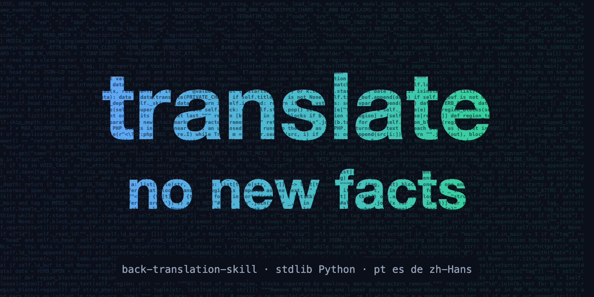

# back-translation-skill

An agent skill (Claude Code and other SKILL.md hosts) for translating a finished English
article into another language **without adding, dropping or changing a fact**, and
proving it.

A model translation reads fluently even when it is wrong. On this skill's first real
article, five meaning changes read perfectly well in the target language. "Divide" and
"multiply" traded places. Two table labels swapped. "Would accept" and "would not
accept" got confused, and so did "Enable" and "Disable". None of them was obvious to a
reader, and all of them passed the mechanical checks of the time. The blind
back-translation caught every one.

## Who it is for

Anyone publishing factual content in more than one language, where a wrong word matters:
articles, blog posts, guides, how-tos, help pages, documentation, policies, reports and
product pages. It suits a team with nobody who reads the target language and no
other way to check the translation.

## Who it is not for

- **Marketing transcreation:** slogans, taglines and campaigns that should be rewritten
  for a market. The checker blocks exactly the changes you want there: a different
  number in a local example, a dropped line, a new angle.
- **Creative writing:** fiction, poetry, humour and wordplay. A pun rendered by its
  meaning shows up as a change in every back-translation round.
- **Short or casual text:** chat messages, emails and notes. Three models and two review
  rounds cost more than the text is worth.
- **Sources in a language other than English:** the English page is the reference the
  checks are built around.
- **Legal or regulated text that needs a certified translation:** this proves a
  translation adds and drops nothing. It doesn't make it legally binding or replace a
  sworn translator.
- **Teams that need native-level style:** it catches wrong meaning, not awkward wording.
  Correct but unidiomatic sentences pass.

## What you need

- **Access to at least two different models.** One translates. A different one
  back-translates without seeing the English and compares the result. A model checking
  its own work misses its own mistakes. See "Choosing models" below.
- **A finished English page:** translate only text that is final. A later correction is
  made in English, then translated again.
- **A target language with a rules file:** Portuguese, Spanish, German or Simplified
  Chinese today. Any other language needs its file written first (see
  [CONTRIBUTING.md](CONTRIBUTING.md)). The checker refuses a language it has no rules for.
- **Pages in HTML, PHP templates or Markdown:** other formats (Word, PDF, CMS databases)
  need exporting first.
- **Python 3.9 or later:** standard library only, nothing to install.
- **Time for two review rounds per page**, and someone to rule on the meaning changes the
  comparator flags.
- **A way to publish one URL per language** if you want the search wiring (hreflang,
  canonical, language switcher).

## Choosing models

Use models from two different vendors, so the back-translation does not share the
translator's blind spots. What the current evidence says:

- In the WMT26 general machine translation shared task (human evaluation, 23 language
  pairs), the strongest off-the-shelf model was Gemini 3.1 Pro, in the top cluster for 15
  of 23 pairs. GPT 5.5 was the next commercial model. No Claude model was in that
  evaluation.
  ([findings paper](https://aclanthology.org/2026.wmt-main.48/))
- In Alconost's sample of more than 3,800 evaluations on real client projects (2025 to
  2026), Gemini ranked first, then Claude, then GPT. DeepL ranked below all three. This
  is a translation vendor's own data, ranked by vendor rather than model version.
  ([Alconost](https://alconost.com/en/blog/best-llm-for-translation-2026))
- Open-weight models ranked lower. In WMT26, Gemma 4 31B, DeepSeek V4 Pro, Qwen 3.6 27B
  and GPT OSS 120B each scored below Gemini 3.1 Pro on at least 22 of the 23 pairs. Google's TranslateGemma (4B, 12B and 27B, 55
  languages) is a dedicated open translation model under the Gemma licence.
  ([model card](https://huggingface.co/google/translategemma-27b-it))

A pairing that fits that evidence: translate with Gemini, back-translate and compare
with Claude or GPT. The checker does not depend on the choice.

## How it works

1. **A different model translates.** The skill fills a strict handover prompt
   (register, number format, modal forms, glossary) and gives it to another model.
2. **A different model back-translates every block blind.** It sees only the translation,
   never the English. A comparator checks the result against the English for numbers,
   negation, must/may strength, scope words and added or dropped qualifiers. Two rounds.
3. **A deterministic checker blocks on mechanical drift.** It's standard-library Python,
   with no network and no model. It compares numbers block by block, with units,
   comparators, scale words and number words. It also compares dates, `[n]` citations,
   code, links and media. Paragraphs, list items, headings and table cells must stay in
   sequence. Title, meta and JSON-LD are checked too, and so is must/must not/should/may
   with negation.
4. **The page is wired in for search.** Own URL, self-canonical, reciprocal hreflang,
   `lang`, translated chrome, and a disclosure that it was translated with AI from the
   English original.

## Install

With the skills CLI:

    npx skills add PaulOgier/back-translation-skill

As a Claude Code plugin:

    /plugin marketplace add PaulOgier/back-translation-skill
    /plugin install back-translation@back-translation-skill

Or copy `skills/back-translation/` into `~/.claude/skills/`.

## Use the checker on its own

    python3 skills/back-translation/scripts/verify_translation.py \
        --en article.md --tr pt/article.md --lang pt

    Translation check: pt/article.md (pt)  Blockers: 0  Warnings: 1

Exit code 0 is clean, 1 means blockers, 2 is an input error. Add `--json` for
machine-readable findings. Add `--back-translation records.json --translator-model
<name>` to require a passing round-two back-translation for every block. The record
format is in `skills/back-translation/references/back-translation.md`.

Input: HTML, PHP templates or Markdown (`.md`, `.mdx`, `.markdown`, with front matter).

With a fact-check sidecar (the `article-fact-check` JSON format, which records each
claim and its sources), pass the translation JSON instead and the checks also run per
claim:

    python3 skills/back-translation/scripts/verify_translation.py article.pt.translation.json

## Languages

The checker's number, date and modal rules exist for these languages:

| Language | Code | Checked |
|---|---|---|
| English (source) | en | yes |
| Portuguese | pt | yes |
| Spanish | es | yes |
| German | de | yes |
| Chinese, Simplified | zh-Hans | yes |
| Any other | | needs a language file first: the checker refuses a language it has no rules for |

Adding a language is one JSON file in `scripts/languages/` plus tests: see
[CONTRIBUTING.md](CONTRIBUTING.md).

## Humanizers

Tone rewriting in the target language is where meaning drifts. After humanising, run the
checker and the back-translation again. These language-specific humanizer skills were
read and grepped for outbound calls before use (MIT, pinned commits):

- Portuguese: [feBittar/humanizer-br](https://github.com/feBittar/humanizer-br) at `b9844f0`
- German: [marmbiz/humanizer-de](https://github.com/marmbiz/humanizer-de) at `09f5762` (its two-pass script launches a model CLI with a budget; the lint scripts are local)
- Chinese: [op7418/humanizer-zh](https://github.com/op7418/humanizer-zh) at `f4518a8`

Read any third-party skill before installing it.

## What it cannot catch

Correct but unidiomatic wording, and nuance that every model gets wrong in the same way.
That is why every translated page carries a disclosure and a way to report an error.

## Licence

MIT. Ideas adapted from other skills are credited in [NOTICE](NOTICE).
